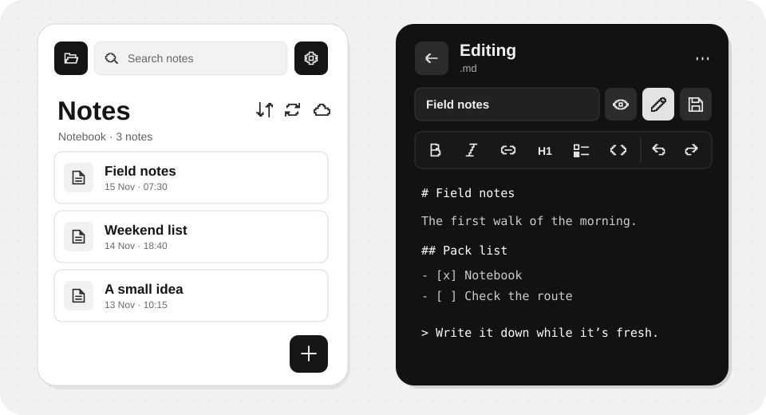

<p align="center"></p>

<h1 align="center">Notier</h1>

<p align="center">A minimal Markdown notebook for Android. Pick a folder, write your notes, and read them in preview.</p>

<p align="center"><a href="README.md">Türkçe</a> · <b>English</b> · <a href="README.ru.md">Русский</a></p>



**Kotlin · Android 8 or later · GNU GPL v3**

## What you can do

- **Work from a folder.** Pick a folder on your device, search your notes, and sort by title or date. Choose a classic list, compact list, or two-column grid.
- **Write and read Markdown.** Switch between source and preview. Use shortcuts for headings, tasks, links, and code, then copy a code block with one tap in preview.
- **Browse Drive folders.** With your permission, Notier opens existing folders and lets you create, move, or trash Markdown notes. Folder cards count Markdown notes.
- **Make it yours.** Choose a light or dark theme, 13 typefaces, and Lucide, crisp pixel, or bold icons. Adjust text, interface, and button sizes separately. The interface supports 42 languages.

## Install on Android

Open the signed APK from the repository’s **Releases** section on your Android device. At first launch, use the folder button at the top left and choose where to keep your notes. Drive is optional. Open the cloud view to choose a Google account and grant access.

## Build with Termux

Extract the project under your Termux home directory. Adjust the `cd` command if you used a different folder name.

```bash
pkg install openjdk-21 aapt2 d8 apksigner python curl unzip
cd ~/Notier
bash derle.sh
```

The build writes `build/Notier.apk`. For Drive in a self-built APK, register its Android package and signing certificate in Google Cloud. See the [build and OAuth guide in Turkish](docs/BUILD.tr.md).

## Privacy and license

- The [Privacy Policy](docs/PRIVACY.md) explains what Notier accesses on the device and in Drive, how it handles that data, and how to revoke access.
- Notier’s source is released under the [GNU General Public License, version 3](LICENSE). See [NOTICE](NOTICE) for the limited Google Play services linking permission and third-party notices.
