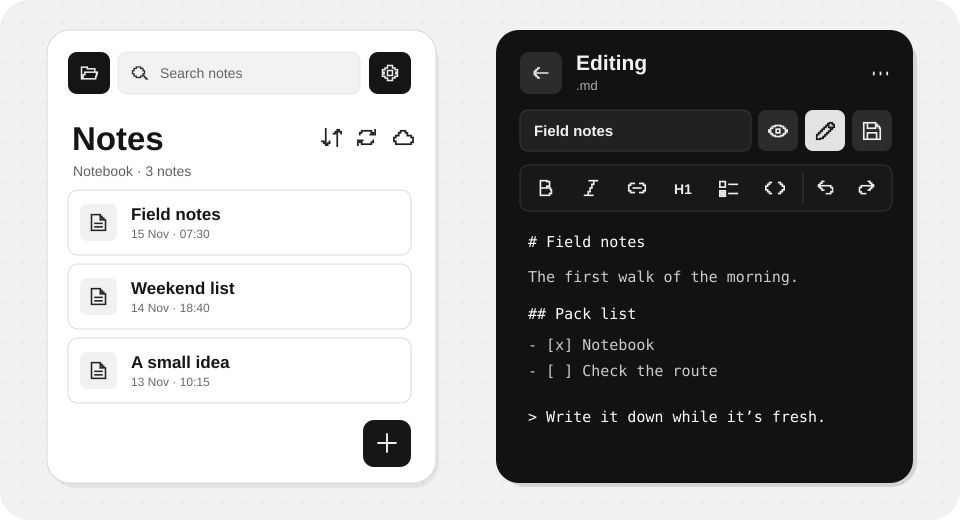
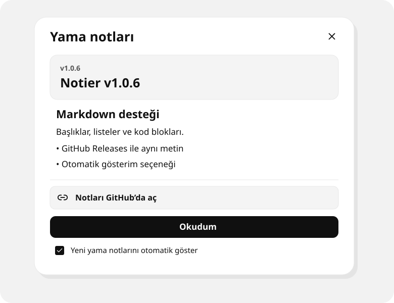

<p align="center"></p>

<h1 align="center">Notier</h1>

<p align="center">Android için sade bir Markdown not defteri. Klasörünü seç, notlarını yaz ve önizlemede oku.</p>

<p align="center"><b>Türkçe</b> · <a href="README.en.md">English</a> · <a href="README.ru.md">Русский</a></p>



<sub>Arayüz çizimi · renkli piksel simgeli not listesi ve koyu temada Markdown içindekiler.</sub>

**Kotlin · Android 8 ve üzeri · GNU GPL v3**

[APK sürümleri](https://github.com/nullnode1/notier-app/releases) · [Proje sitesi](https://nullnode1.github.io/notier-app/) · [Kullanım kılavuzu](docs/BUILD.tr.md)

## Notier ile neler yapabilirsin?

- **Klasörle çalış.** Cihazdan bir klasör seç, notları ada ya da tarihe göre sırala ve ara. Klasik liste, kompakt liste ve iki sütunlu ızgara arasında geçiş yap.
- **Markdown yaz ve oku.** Ham metin ile önizleme arasında geçiş yap. Başlık, görev listesi, bağlantı ve kod için editör kısayollarını kullan. Önizlemede kod bloklarını tek dokunuşla kopyala.
- **Drive’daki klasörlerini gez.** İzin verdiğinde mevcut klasörleri açabilir, Markdown notu oluşturabilir, taşıyabilir veya çöp kutusuna gönderebilirsin. Klasör kartları Markdown notlarını sayar.
- **Görünümü özelleştir.** Açık ve koyu temayı, 13 yazı tipini, Lucide, net piksel ve kalın çizgi simgelerini dene. Metin, arayüz ve düğme boyutları ile köşe yuvarlaklığını ayrı ayrı ayarla. Arayüzde 54 dil ve alfabe seçeneği bulunur.
- **Başlığa atla.** Önizlemede içindekiler simgesine dokun ve istediğin Markdown başlığını seç. `[Başlık](#başlık)` biçimindeki bölüm bağlantıları da çalışır.
- **Güncellemeleri denetle.** Ayarlar’dan veya üst gezinti menüsünden GitHub Releases’i denetle. İstersen yeni Android sürümleri için bildirimleri aç.

## Yama notları

| Sürüm | Değişiklikler |
| --- | --- |
| [v1.0.4](docs/updates/v1.0.4.md) | Çevrimdışı güncelleme sonucu, renkli piksel simgeleri ve uygulama içi yama notları |
| [v1.0.3](docs/updates/v1.0.3.md) | Markdown içindekiler ve yeni dil ve alfabe seçenekleri |



## İlk notunu yaz

1. Sol üstteki klasör düğmesiyle cihazında bir klasör seç. Notier bu klasördeki `.md` ve `.markdown` dosyalarını listeler.
2. **+** düğmesine dokun, notuna bir başlık ver ve metni yaz. **Kaydet** düğmesi başlığı dosya adına dönüştürür.
3. **Göz** düğmesi biçimlendirilmiş önizlemeyi açar. **Kalem** ile Markdown metnine dönebilirsin. Var olan notlar önizlemede açılır.
4. Ayrı bir dosya hazırlamak için not menüsündeki **Farklı kaydet** seçeneğini kullan. Listeye döndüğünde bir nota basılı tutarak sabitleyebilir, yeniden adlandırabilir veya silebilirsin.

~~~markdown
# Hafta sonu

- [x] Rotayı seç
- [ ] Çantayı hazırla

> Kısa notları burada tut.
~~~

### Yerel klasör ve Google Drive

| İşlem | Cihazdaki klasör | Google Drive |
| --- | --- | --- |
| Erişim | Android dosya seçicisinden klasör izni | Bulut ekranından Google hesabı ve izin |
| Notların konumu | Cihazda seçtiğin klasör | Notier’de açık olan Drive klasörü |
| Yenileme | Listeyi aşağı çek veya yenileme simgesine dokun | Aynı hareketle Drive listesini yeniden sorgula |

Önizleme tabloları, görev listelerini, kod bloklarını ve bağlantıları destekler. Notta çevrim içi resim, ses veya video varsa Android System WebView ilgili bağlantıyı kullanır. Google hesabının bağlantısını **Drive hesabı → Drive oturumunu kapat** yoluyla yönetebilirsin.

## Android’e kurulum

Bu deponun **Releases** bölümündeki imzalı APK’yı Android cihazında aç. İlk kullanımda sol üstteki klasör düğmesine dokun ve notlarını saklayacağın klasörü seç. Drive isteğe bağlıdır. Bulut ekranından Google hesabını seçip erişim verebilirsin.

Yeni Android sürümü için GitHub’da `v1.0.3` gibi bir etiketle kararlı bir Release yayımla ve imzalı APK’yı sürüm dosyası olarak yükle. Notier, yayımlanmış APK içeren sürümleri denetler. Bildirim zamanını Android belirler.

## Termux’ta derleme

Projeyi Termux ana dizinine çıkardıktan sonra aşağıdaki komutları çalıştır. Kaynak klasörünün adı farklıysa `cd` satırını ona göre düzenle.

```bash
pkg install openjdk-21 aapt2 d8 apksigner python curl unzip
cd ~/Notier
bash derle.sh
```

Derlenen APK `build/Notier.apk` konumuna yazılır. Kendi imzanla derlediğin APK’daki Drive bağlantısı için [geliştirici kılavuzundaki OAuth adımlarını](docs/BUILD.tr.md#geliştiriciler-için-google-cloud) izle.

## Koda nereden başlanır?

Notier, Kotlin ile yazılmış yerel Android görünümlerini kullanır. Ekranlar ve gezinme `MainActivity.kt` içinde. Dosya erişimi, Drive, taslaklar ve Markdown önizlemesi ayrı modüllerde.

| İlk değişiklik | İlgili kaynak |
| --- | --- |
| Dosya adı veya uzantı kuralı | [NoteNames.kt](app/src/main/kotlin/app/notier/NoteNames.kt) |
| Bir biçimlendirme kısayolu | [MarkdownShortcut.kt](app/src/main/kotlin/app/notier/MarkdownShortcut.kt) |
| Yerel kaydetme ve taslak kurtarma | [Notes.kt](app/src/main/kotlin/app/notier/Notes.kt) ve [DraftStore.kt](app/src/main/kotlin/app/notier/DraftStore.kt) |
| Google Drive istekleri | [DriveApi.kt](app/src/main/kotlin/app/notier/DriveApi.kt) |
| Markdown önizlemesi | [Markdown.kt](app/src/main/kotlin/app/notier/Markdown.kt) |

İlk katkını denemek için örnek metni yerel bir dosyaya kaydet. Notu aç, düzenle, farklı kaydet ve yeni dosyayı tekrar aç. Bir sorun bildirirken Android sürümünü, Notier sürümünü ve sorunu tekrarlama adımlarını yaz. [Sorun bildirme](https://github.com/nullnode1/notier-app/issues).


## Gizlilik ve lisans

Sürüm, geliştirici, GitHub bağlantısı ve çevrimdışı politika metinleri **Ayarlar → Hakkında** ekranındadır.

- [Gizlilik politikası](docs/PRIVACY.tr.md) cihazda ve Drive’da hangi bilgilerin kullanıldığını, saklandığını ve erişimin nasıl geri alınacağını açıklar.
- Notier’in kaynak kodu [GNU Genel Kamu Lisansı, sürüm 3](LICENSE) ile yayımlanır. Google Play Hizmetleri için sınırlı bağlantı izni ve üçüncü taraf lisans bilgileri [NOTICE](NOTICE) dosyasındadır.
