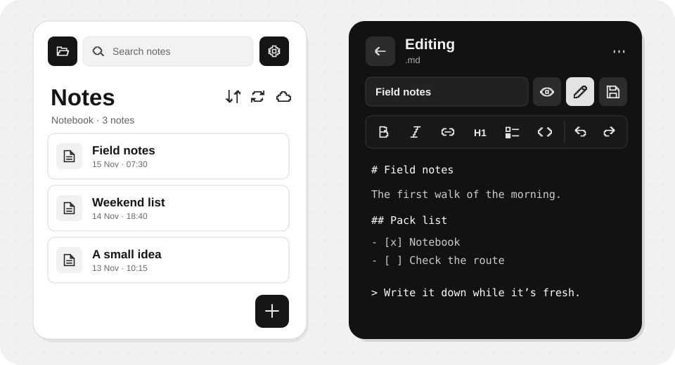

<p align="center"></p>

<h1 align="center">Notier</h1>

<p align="center">Лаконичный блокнот Markdown для Android. Выберите папку, запишите мысли и откройте их в режиме просмотра.</p>

<p align="center"><a href="README.md">Türkçe</a> · <a href="README.en.md">English</a> · <b>Русский</b></p>



**Kotlin · Android 8 и новее · GNU GPL v3**

## Возможности

- **Работайте с папками.** Выберите папку на устройстве, найдите заметку по названию и отсортируйте список по имени или дате. Доступны обычный список, компактный список и сетка в две колонки.
- **Пишите и читайте Markdown.** Переключайтесь между исходным текстом и предварительным просмотром. Используйте кнопки для заголовков, задач, ссылок и кода. В режиме просмотра блок кода можно скопировать одним нажатием.
- **Открывайте папки Google Диска.** После предоставления доступа можно просматривать существующие папки, создавать и перемещать Markdown-заметки и отправлять их в корзину. На карточке папки указано количество Markdown-заметок.
- **Настройте оформление.** Выберите светлую или тёмную тему, один из 13 шрифтов и стиль значков. Доступны Lucide, чёткие пиксельные и жирные контурные значки. Размеры текста, интерфейса и кнопок настраиваются отдельно. Интерфейс доступен на 42 языках.

## Установка на Android

Откройте подписанный APK из раздела **Releases** репозитория на Android-устройстве. При первом запуске нажмите кнопку папки в левом верхнем углу и выберите, где хранить заметки. Google Диск можно подключить в облачном разделе, выбрав аккаунт и предоставив разрешение.

## Сборка в Termux

Распакуйте проект в домашнюю папку Termux. Если вы выбрали другое имя, измените путь в команде `cd`.

```bash
pkg install openjdk-21 aapt2 d8 apksigner python curl unzip
cd ~/Notier
bash derle.sh
```

Готовый APK появится по пути `build/Notier.apk`. Для доступа к Диску из собственной сборки зарегистрируйте имя пакета и сертификат подписи в Google Cloud. Подробности приведены в [инструкции по сборке и OAuth на турецком](docs/BUILD.tr.md).

## Конфиденциальность и лицензия

- В [политике конфиденциальности](docs/PRIVACY.ru.md) описаны доступ к данным на устройстве и на Диске, их обработка и способ отзыва разрешений.
- Исходный код Notier распространяется по [GNU General Public License, версия 3](LICENSE). Ограниченное разрешение на связывание с сервисами Google Play и информация о сторонних лицензиях приведены в файле [NOTICE](NOTICE).
