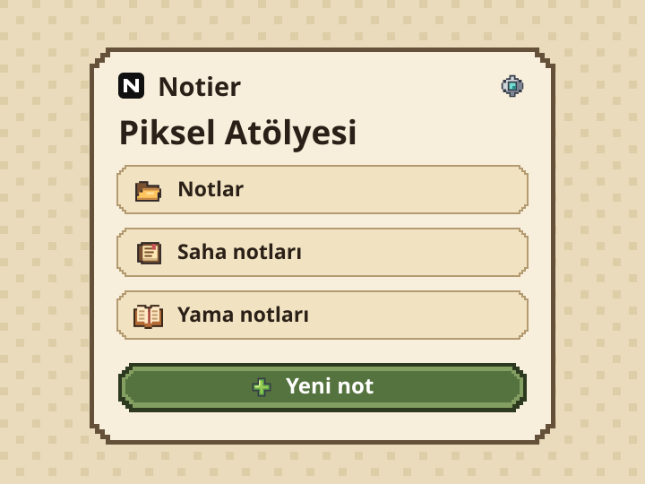

<p align="center"></p>

<h1 align="center">Notier</h1>

<p align="center">Лаконичный блокнот Markdown для Android. Выберите папку, запишите мысли и откройте их в режиме просмотра.</p>

<p align="center"><a href="README.md">Türkçe</a> · <a href="README.en.md">English</a> · <b>Русский</b></p>


<sub>Иллюстрация интерфейса · цветные пиксельные значки и оглавление в тёмном режиме просмотра.</sub>

**Kotlin · Android 8 и новее · GNU GPL v3**

[Версии APK](https://github.com/nullnode1/notier-app/releases) · [Сборка и использование (на турецком)](docs/BUILD.tr.md) · [Сайт проекта](https://nullnode1.github.io/notier-app/)

## Возможности

- **Работайте с папками.** Выберите папку на устройстве, найдите заметку по названию и отсортируйте список по имени или дате. Доступны обычный список, компактный список и сетка в две колонки.
- **Пишите и читайте Markdown.** Переключайтесь между исходным текстом и предварительным просмотром. Используйте кнопки для заголовков, задач, ссылок и кода. В режиме просмотра блок кода можно скопировать одним нажатием.
- **Открывайте папки Google Диска.** После предоставления доступа можно просматривать существующие папки, создавать и перемещать Markdown-заметки и отправлять их в корзину. На карточке папки указано количество Markdown-заметок.
- **Настройте оформление.** Выберите светлую, тёмную или пиксельную тему, один из 13 шрифтов и стиль значков. Доступны Lucide, чёткие пиксельные и жирные контурные значки. Размеры текста, интерфейса и кнопок настраиваются отдельно. В интерфейсе доступны 54 варианта языка и письменности.
- **Переходите к разделам.** В режиме просмотра откройте оглавление и выберите заголовок. Ссылки вида `[Раздел](#раздел)` ведут к разделам той же заметки.
- **Проверяйте обновления.** Проверка GitHub Releases доступна в настройках и верхнем меню. Можно включить уведомления о новых версиях для Android.

## Примечания к выпускам

| Версия | Изменения |
| --- | --- |
| [v1.0.5](docs/updates/v1.0.5.en.md) | Примечания GitHub, экран приветствия, пиксельная тема и мобильный сайт |
| [v1.0.4](docs/updates/v1.0.4.en.md) | Результаты проверки без сети, цветные пиксельные значки и примечания в приложении |
| [v1.0.3](docs/updates/v1.0.3.en.md) | Оглавление, новые языки и варианты письменности |



## Первая заметка

1. Нажмите кнопку папки в левом верхнем углу и выберите папку на устройстве. Notier покажет файлы с расширениями `.md` и `.markdown`.
2. Нажмите **+**, введите заголовок и напишите заметку. Команда **Сохранить** использует заголовок как имя файла.
3. Нажмите значок **глаза** для просмотра и **карандаша** для возврата к исходному тексту Markdown. Существующие заметки открываются в режиме просмотра.
4. Чтобы создать отдельный файл, выберите **Сохранить как** в меню заметки. Долгое нажатие на заметку в списке открывает команды закрепления, переименования и удаления.

~~~markdown
# Выходные

- [x] Выбрать маршрут
- [ ] Собрать рюкзак

> Короткие заметки можно хранить здесь.
~~~

### Папки устройства и Google Диск

| Действие | Папка устройства | Google Диск |
| --- | --- | --- |
| Доступ | Разрешить доступ к папке через Android | Выбрать аккаунт и выдать разрешение в облачном разделе |
| Хранение | Выбранная папка устройства | Папка Диска, открытая в Notier |
| Обновление | Потянуть список вниз или нажать кнопку обновления | Те же действия запрашивают свежий список с Диска |

Предпросмотр поддерживает таблицы, списки задач, блоки кода и ссылки. Android System WebView может загружать изображения, аудио и видео по ссылкам из заметки. Для отключения аккаунта выберите **Аккаунт Диска → Выйти из Диска**.

## Установка на Android

Откройте подписанный APK из раздела **Releases** репозитория на Android-устройстве. При первом запуске нажмите кнопку папки в левом верхнем углу и выберите, где хранить заметки. Google Диск можно подключить в облачном разделе, выбрав аккаунт и предоставив разрешение.

Для новой версии Android опубликуйте стабильный релиз GitHub с тегом наподобие `v1.0.5` и прикрепите подписанный APK. Notier проверяет опубликованные релизы с APK. Время фоновой проверки определяет Android. Добавьте примечания в описание релиза GitHub. Notier загружает описание и сохраняет его для чтения без сети.

## Сборка в Termux

Распакуйте проект в домашнюю папку Termux. Если вы выбрали другое имя, измените путь в команде `cd`.

```bash
pkg install openjdk-21 aapt2 d8 apksigner python curl unzip
cd ~/Notier
bash derle.sh
```

Готовый APK появится по пути `build/Notier.apk`. Для доступа к Диску из собственной сборки зарегистрируйте имя пакета и сертификат подписи в Google Cloud. Подробности приведены в [инструкции по сборке и OAuth на турецком](docs/BUILD.tr.md).

## С чего начать работу с кодом

Notier написан на Kotlin и использует стандартные компоненты интерфейса Android. `MainActivity.kt` управляет экранами и навигацией. Работа с файлами, Google Диском, черновиками и предпросмотром вынесена в отдельные модули.

| Первое изменение | Исходный код |
| --- | --- |
| Правила имён файлов и расширений | [NoteNames.kt](app/src/main/kotlin/app/notier/NoteNames.kt) |
| Кнопка форматирования в редакторе | [MarkdownShortcut.kt](app/src/main/kotlin/app/notier/MarkdownShortcut.kt) |
| Сохранение файлов и восстановление черновиков | [Notes.kt](app/src/main/kotlin/app/notier/Notes.kt) и [DraftStore.kt](app/src/main/kotlin/app/notier/DraftStore.kt) |
| Запросы к Google Диску | [DriveApi.kt](app/src/main/kotlin/app/notier/DriveApi.kt) |
| Предварительный просмотр Markdown | [Markdown.kt](app/src/main/kotlin/app/notier/Markdown.kt) |

Для первой проверки сохраните пример на устройстве. Откройте и измените заметку, сохраните копию и снова её откройте. В сообщении об ошибке укажите версии Android и Notier и шаги для воспроизведения. [Сообщить об ошибке](https://github.com/nullnode1/notier-app/issues).


## Конфиденциальность и лицензия

В разделе **Настройки → О приложении** доступны версия, страница разработчика, репозиторий GitHub и тексты политик для чтения без интернета.

- В [политике конфиденциальности](docs/PRIVACY.ru.md) описаны доступ к данным на устройстве и на Диске, их обработка и способ отзыва разрешений.
- Исходный код Notier распространяется по [GNU General Public License, версия 3](LICENSE). Ограниченное разрешение на связывание с сервисами Google Play и информация о сторонних лицензиях приведены в файле [NOTICE](NOTICE).
